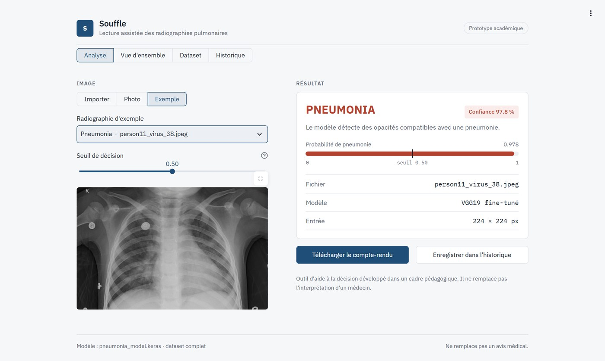
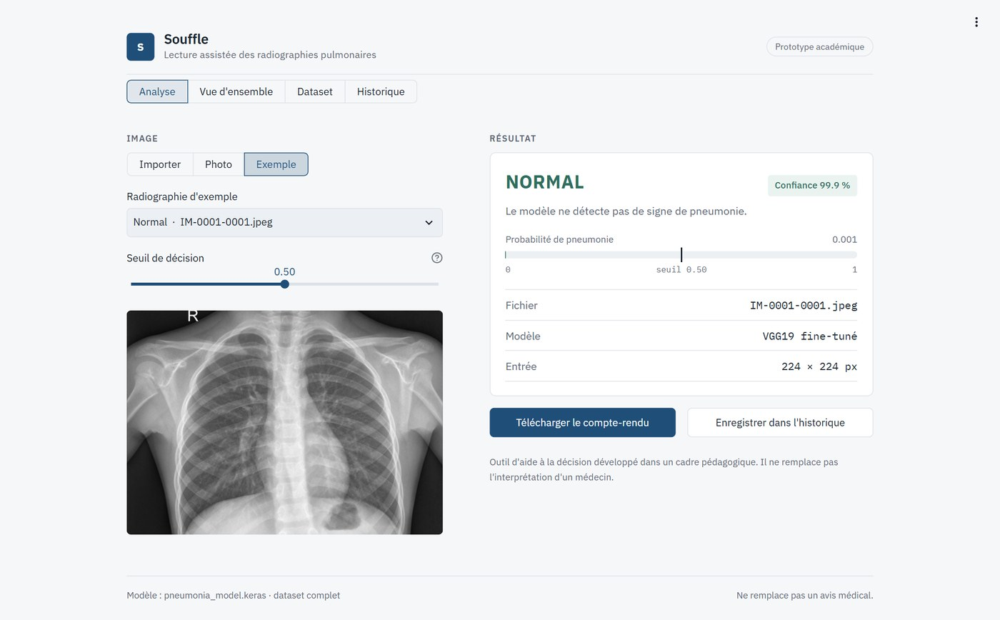
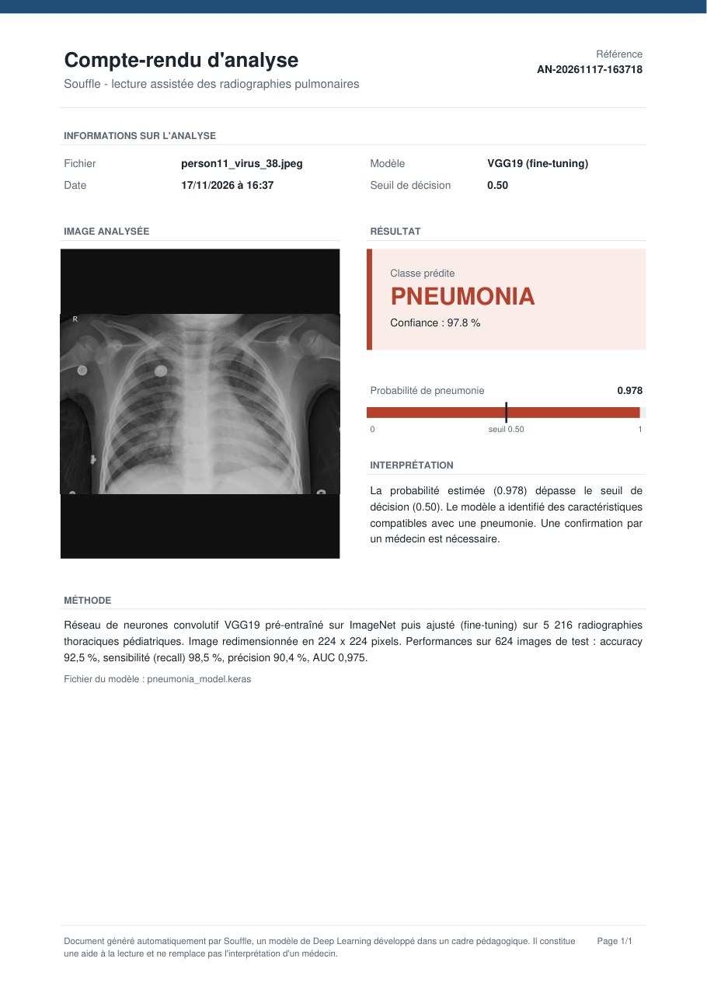
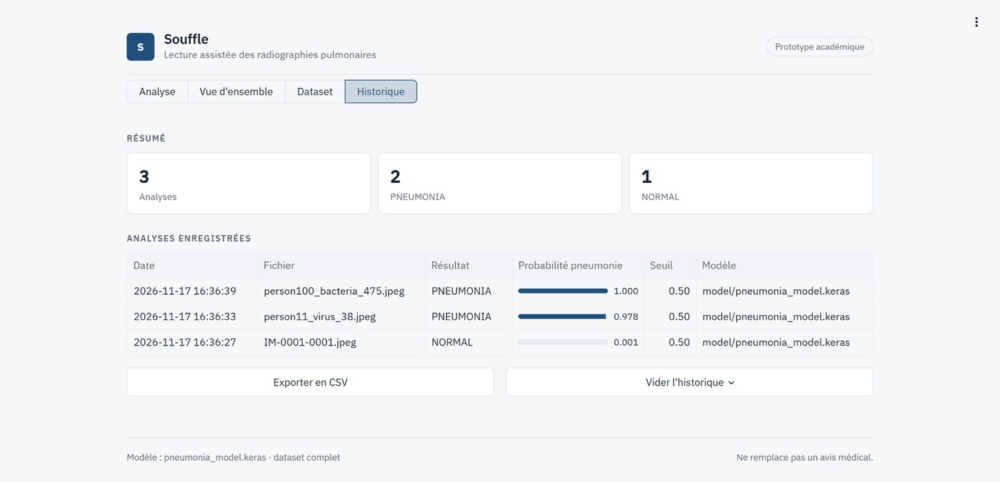
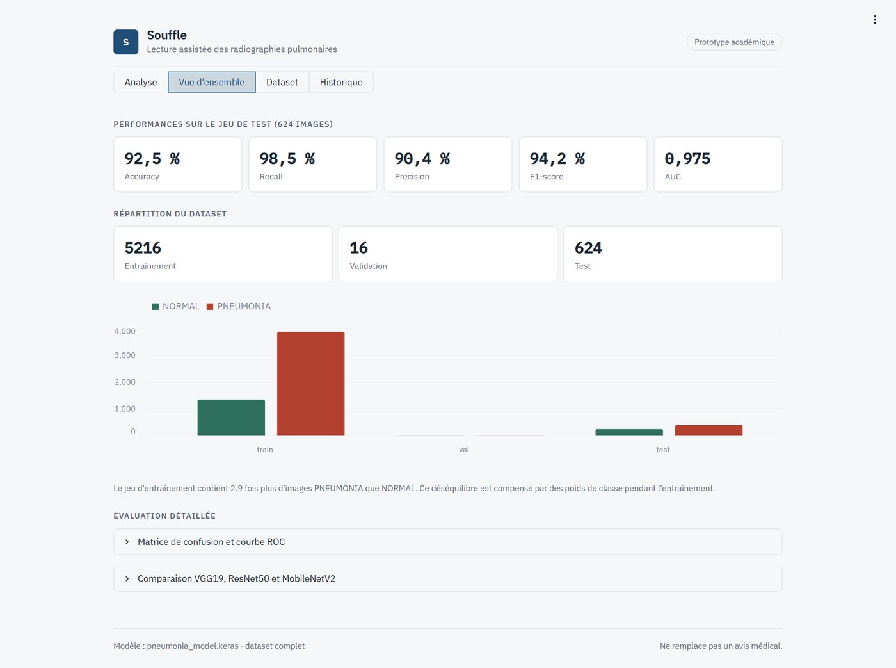
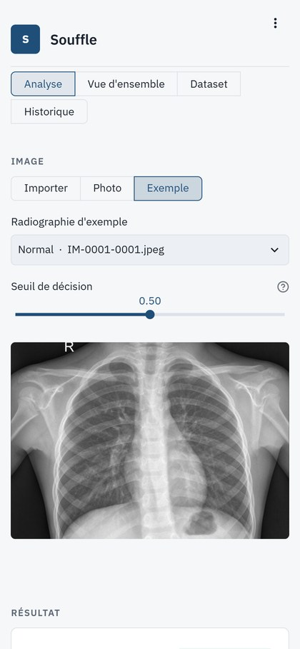
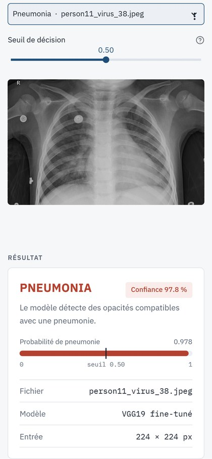
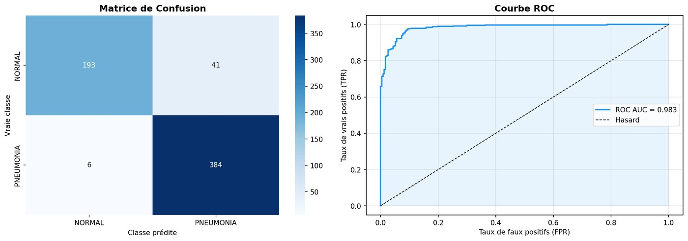

# Souffle

**Lecture assistée des radiographies pulmonaires.** Souffle analyse une radiographie du thorax et indique si elle présente des signes de pneumonie. Le modèle est un VGG19 adapté par transfer learning. L'application web, faite avec Streamlit, fonctionne sur ordinateur et sur téléphone.

**[Ouvrir Souffle en ligne](https://pneumonia-xray-detection-n2hpdnl2jmwzrtf7qd6mp5.streamlit.app/)** : aucune installation nécessaire, fonctionne aussi sur téléphone.



| Accuracy | Rappel (pneumonie) | Précision | F1-score | AUC |
|:-:|:-:|:-:|:-:|:-:|
| 92,5 % | 98,5 % | 90,4 % | 94,2 % | 0,975 |

*Résultats sur les 624 images du jeu de test. Sur 390 radiographies de pneumonie, 384 sont détectées.*

> Projet académique. Souffle est un outil d'aide à la lecture et ne remplace pas l'avis d'un médecin.

---

## Sommaire

- [Utiliser la plateforme](#utiliser-la-plateforme)
- [Les pages de l'application](#les-pages-de-lapplication)
- [Sur téléphone](#sur-téléphone)
- [Comment fonctionne le modèle](#comment-fonctionne-le-modèle)
- [Lancer le projet en local](#lancer-le-projet-en-local)
- [Structure du projet](#structure-du-projet)
- [Déploiement](#déploiement)
- [Limites](#limites)

---

## Utiliser la plateforme

1. **Ouvrez [le lien de l'application](https://pneumonia-xray-detection-n2hpdnl2jmwzrtf7qd6mp5.streamlit.app/).** Si une page indique que l'application est en veille, cliquez sur *Yes, get this app back up*. Le redémarrage prend une à deux minutes.
2. **Choisissez une image** dans l'onglet *Analyse* :
   - **Importer** : une radiographie depuis votre ordinateur (JPG, PNG, BMP ou TIFF, 20 Mo maximum) ;
   - **Photo** : l'appareil photo du téléphone ou de l'ordinateur, pratique pour photographier un cliché ;
   - **Exemple** : huit radiographies du jeu de test, pour essayer sans avoir d'image sous la main.
3. **Lisez le résultat** à droite : la classe prédite (NORMAL ou PNEUMONIA), la confiance et la jauge de probabilité. Le trait vertical sur la jauge correspond au seuil de décision.
4. **Ajustez le seuil** si besoin. Au-dessus du seuil, l'image est classée PNEUMONIA. Un seuil bas détecte plus de cas mais donne plus de fausses alertes. Le résultat se met à jour immédiatement.
5. **Téléchargez le compte-rendu** au format PDF, ou **enregistrez l'analyse** dans l'historique.

Si l'image importée est en couleur, l'application prévient qu'il ne s'agit probablement pas d'une radiographie : le résultat n'a alors pas de sens.

## Les pages de l'application

### Analyse

La page principale : l'image et le seuil à gauche, le résultat à droite.



### Compte-rendu PDF

Chaque analyse peut être téléchargée sous forme de compte-rendu d'une page. Il contient une référence unique, la radiographie, le verdict, la jauge de probabilité, une interprétation et un rappel de la méthode.

<p align="center">
  
</p>

### Historique

Les analyses enregistrées apparaissent dans un tableau, avec un résumé par classe. L'historique peut être exporté en CSV ou vidé, après confirmation.



### Vue d'ensemble

Les performances du modèle, la répartition du jeu de données et les graphiques d'évaluation, réunis sur une seule page.



### Dataset

Une galerie d'images tirées au hasard, filtrées par split et par classe. En ligne, la galerie affiche les huit images d'exemple, car le jeu de données complet (2,4 Go) n'est pas hébergé.

## Sur téléphone

L'interface s'adapte aux petits écrans : les colonnes s'empilent et la navigation reste en haut de page. Le bouton *Photo* ouvre directement l'appareil photo du téléphone.

<p align="center">
  
  &nbsp;&nbsp;&nbsp;
  
</p>

Pour l'utiliser comme une application, ouvrez le lien dans Chrome (Android) ou Safari (iPhone), puis choisissez **Ajouter à l'écran d'accueil**. Une icône apparaît et ouvre Souffle directement.

## Comment fonctionne le modèle

**Données.** Le jeu [Chest X-Ray Images (Pneumonia)](https://www.kaggle.com/datasets/paultimothymooney/chest-xray-pneumonia) contient 5 856 radiographies d'enfants de 1 à 5 ans : 5 216 pour l'entraînement, 16 pour la validation et 624 pour le test. L'entraînement compte près de trois fois plus d'images de pneumonie que d'images normales. Ce déséquilibre est compensé par des poids de classe.

**Prétraitement.** Les images sont redimensionnées en 224 × 224 et normalisées entre 0 et 1. Pendant l'entraînement, une augmentation légère est appliquée : rotation de ±15°, décalages, zoom, retournement horizontal et variation de luminosité.

**Architecture.** On part de VGG19 pré-entraîné sur ImageNet, sans sa partie finale. On y ajoute une tête de classification : Global Average Pooling, BatchNorm, Dense 256, Dropout 0,5, Dense 128, Dropout 0,3, puis une sortie sigmoïde qui donne la probabilité de pneumonie.

**Entraînement en deux phases.**

| | Phase 1 | Phase 2 |
|---|---|---|
| Couches de VGG19 | gelées | 20 dernières dégelées |
| Taux d'apprentissage | 1e-4 | 1e-5 |
| Époques | 20 | 15 |

**Résultats.**



Le modèle privilégie le rappel : il manque très peu de cas de pneumonie (6 sur 390), au prix de fausses alertes sur les radiographies normales (41 sur 234). C'est pour cette raison que le seuil est réglable dans l'application.

## Lancer le projet en local

TensorFlow ne prend pas encore en charge Python 3.14 : utilisez **Python 3.11**.

```bash
git clone https://github.com/aminecharro01/pneumonia-xray-detection.git
cd pneumonia-xray-detection

python -m venv venv            # avec Python 3.11
venv\Scripts\activate          # Windows  (macOS / Linux : source venv/bin/activate)
pip install -r requirements.txt

streamlit run app.py
```

L'application s'ouvre sur http://localhost:8501. Pour la tester sur un téléphone connecté au même Wi-Fi, ouvrez l'adresse *Network URL* affichée par Streamlit.

### Réentraîner le modèle (optionnel)

1. Téléchargez le [jeu de données sur Kaggle](https://www.kaggle.com/datasets/paultimothymooney/chest-xray-pneumonia) et placez l'archive dans le dossier du projet sous le nom `chest-xray-pneumonia.zip`.
2. Installez les dépendances du notebook : `pip install -r requirements-notebook.txt`.
3. Exécutez `deepLearning.ipynb` dans l'ordre. Sur CPU, l'entraînement complet prend une dizaine d'heures. Un GPU, par exemple sur Google Colab, est fortement conseillé.

## Structure du projet

```
├── app.py                      Interface Streamlit : pages, chargement du modèle, prédiction
├── history.py                  Historique des analyses (SQLite)
├── report.py                   Génération du compte-rendu PDF (fpdf2)
├── deepLearning.ipynb          Préparation des données, entraînement, évaluation
├── model/
│   └── pneumonia_model.keras   Modèle final (81 Mo)
├── samples/                    8 radiographies d'exemple (NORMAL et PNEUMONIA)
├── docs/screenshots/           Captures utilisées dans ce README
├── .streamlit/config.toml      Thème : couleurs, police IBM Plex Sans
├── requirements.txt            Dépendances de l'application
└── requirements-notebook.txt   Dépendances supplémentaires pour le notebook
```

## Déploiement

L'application est hébergée sur **Streamlit Community Cloud**, relié à ce dépôt GitHub. Chaque `git push` sur la branche `main` redéploie l'application automatiquement.

Pour déployer votre propre copie :
1. Forkez le dépôt.
2. Sur [share.streamlit.io](https://share.streamlit.io), cliquez sur **Create app**, puis choisissez le dépôt, la branche `main` et le fichier `app.py`.
3. Dans **Advanced settings**, sélectionnez **Python 3.11**, puis lancez le déploiement.

Le modèle d'origine pesait 242 Mo, au-delà de la limite de GitHub. Il a été réenregistré au format `.keras` sans l'état de l'optimiseur : il pèse maintenant 81 Mo et donne exactement les mêmes prédictions.

## Limites

- **Jeu de validation** : il ne contient que 16 images, ce qui rend le choix du meilleur modèle peu fiable.
- **Population** : toutes les images viennent d'un seul hôpital et concernent des enfants. Rien ne garantit les mêmes performances sur des radiographies d'adultes.
- **Explicabilité** : le modèle n'indique pas sur quelle zone de l'image il s'appuie. Ajouter une carte Grad-CAM est la prochaine étape envisagée.
- **Historique en ligne** : sur l'offre gratuite de Streamlit, l'historique est effacé à chaque redémarrage du serveur.

## Auteur

**Amine Charro**, 5ᵉ année Ingénierie Informatique et Réseaux, EMSI Rabat.
Projet encadré par Pr Said Benlakhdar, année universitaire 2026–2027.
